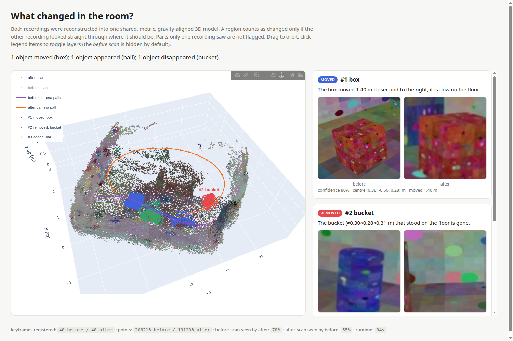

# roomdiff: what changed in the room?

You give it two phone videos of the same room, one from before and one from after you moved things around. It returns:

* a **shared, metric, gravity-aligned 3D model** of the room built from both recordings,
* the **objects that were moved, added or removed**, as 3D clusters with bounding boxes,
* a **label and a plain-English sentence** for each change ("The box moved 1.40 m closer and to the right; it is now on the floor."),
* an **interactive HTML report** (3D viewer plus a before/after crop for every change), and `changes.json` for robots/scripts.

It runs on a laptop CPU in about 1.5 minutes per pair. No GPU or cloud is needed. If `ANTHROPIC_API_KEY` is set, Claude writes the labels and descriptions; otherwise everything runs offline with CLIP.



## Quick start

```bash
python3 -m venv .venv && source .venv/bin/activate
pip install torch torchvision --index-url https://download.pytorch.org/whl/cpu
pip install -r requirements.txt

python -m roomdiff before.mp4 after.mp4 -o out/myroom
# open out/myroom/report.html
```

The first run downloads Depth Anything V2 (~100 MB) and CLIP (~600 MB) from Hugging Face.

| flag | meaning |
|---|---|
| `-o DIR` | output directory (default `out`) |
| `--frames N` | keyframes per video (default 40; use 60 for long or large rooms) |
| `--claude` / `--no-claude` | force Claude on or off for labelling (default: on if `ANTHROPIC_API_KEY` is set) |
| `--fresh` | ignore the cached reconstruction in `DIR/work/` (detection and report re-runs reuse it by default) |

Outputs in `DIR/`: `report.html`, `changes.json`, `before.ply`, `after.ply` (fused point clouds in the shared frame).

### Try it without a phone

A synthetic before/after pair with known ground truth is included (`examples/synthetic`): a red box was moved, a yellow ball was added and a blue bin was removed.

```bash
python -m roomdiff examples/synthetic/before.mp4 examples/synthetic/after.mp4 -o examples/synthetic/output
python scripts/eval_synthetic.py examples/synthetic/output      # scores against gt.json
python scripts/make_synthetic.py                                 # re-render the scene
```

```
GT removed red box   -> FOUND as 'box'    (0.20 m off)
GT added   red box   -> FOUND as 'box'    (0.21 m off)
GT added   yellow ball -> FOUND as 'ball' (0.12 m off)
GT removed blue bin  -> FOUND as 'bucket' (0.17 m off)
recall 4/4 ; false positives 0
```

### Recording tips (these matter more than any parameter)

* Record two **slow** 20–40 s walks of the area. Hold the phone upright and keep moving sideways; don't stand in one spot and turn on the spot.
* Start and end both videos looking at the **same static stuff** (walls, big furniture). That's what links the two recordings together.
* Use different paths for the two videos if you like, but make sure **the places where things changed are visible in both**. A spot that only one video saw can't be judged, and the system deliberately won't guess.
* Keep the lights the same. Plain white walls with nothing on them are hard for SfM.

## How it works

```
before.mp4 ─┐  sharpest frame      joint SfM        mono metric depth      fuse per session      visibility-aware        CLIP / Claude
after.mp4  ─┴─ per time bin  ──▶  (COLMAP, both ──▶ (Depth Anything V2) ──▶ (multi-view      ──▶  change test       ──▶  labels, moved-
                                   videos at once)   aligned to SfM          consistent cloud)     + cluster + vetoes     matching, text
```

1. **Keyframes** (`frames.py`). The video is split into N time bins and the sharpest frame (Laplacian variance) is kept from each. Motion blur is what usually breaks handheld SfM.
2. **One shared frame** (`sfm.py`). Frames from *both* videos go into one COLMAP reconstruction (SIFT, exhaustive matching, one camera model per video). The static majority of the room ties the sessions together, and moved objects are rejected as RANSAC outliers. So the shared 3D representation falls out of the registration itself, with no separate cloud-to-cloud alignment step.
3. **Metric, gravity-aligned world** (`geometry.py`, `depth.py`). Metric depth predictions fix the SfM scale. The floor (lowest well-supported horizontal plane) defines up and z = 0, and the first frame defines "forward", so descriptions can say *on the floor*, *0.7 m up* or *to the left*.
4. **Dense depth** (`depth.py`). COLMAP's dense MVS needs CUDA, so each keyframe instead gets Depth Anything V2 (metric indoor) depth. It is fitted to the SfM points with a robust scale+shift and then a **smooth correction field** interpolated from the sparse points. That corrects the low-frequency warping monocular depth has (curved walls), which a global scale can't fix. Flying pixels at depth edges are masked.
5. **Fusion** (`fusion.py`). Each session is back-projected and voxelised at 2 cm. A voxel is kept only if ≥2 frames agree on it and the session's own frames don't see through it. That is TSDF-style free-space carving, done explicitly.
6. **Change detection** (`changes.py`). This is the core. For every point of one session, each frame of the *other* session votes:
   * **consistent**: it sees a surface at that depth.
   * **free**: it sees *through* it (observed depth clearly farther). This is the only evidence of change.
   * **occluded**: something is in front. This is **not** evidence.
   * **unobserved**: outside every frame. This is **not** evidence either.

   A point is changed only with ≥3 free votes, ≥70% free ratio, and no nearby point in the other cloud. This rule is what separates real changes from viewpoint differences, occlusion and incomplete coverage. The depth tolerance grows with distance, both the other camera's distance and the distance the point was originally seen from, because monocular depth error grows with range. Changed points are clustered with DBSCAN, and three cheap vetoes remove depth artefacts:
   * **SfM anchor veto**: if a feature was matched in *both* videos on the "changed" surface, it physically didn't change.
   * **displacement**: the surface must have vanished, not shifted by a few centimetres.
   * **photometric**: where an object was removed, the other video sees what was behind it, which looks different. If it sees the same colour, it's the same surface at a slightly wrong depth. (On the synthetic scene this separated every false positive, ≤0.03, from every real change, ≥0.25.)
7. **Semantics** (`semantics.py`). For each cluster the best view (most unoccluded, most central) is chosen, the object is cropped, and the same 3D box is cropped in the other session's best "see-through" view. That produces the before/after pair on each card. CLIP labels the crop zero-shot from a household vocabulary. Removed and added clusters are paired into **moved** with Hungarian matching on CLIP appearance, size and colour, then ICP refines the displacement. Descriptions are built from the geometry (distance, direction, support surface, size). With an API key, Claude sees the crops plus those geometric facts and rewrites the labels, descriptions and a room summary.

## Design choices and tradeoffs

* **Explicit visibility reasoning over learned change detection.** Every decision can be traced to "camera X saw through point Y". Being conservative is deliberate: an unobserved region is reported as coverage (the stats show what % of each scan the other video saw), never as a change.
* **Monocular depth plus SfM instead of dense MVS or a big 3D foundation model.** It runs on CPU in minutes. The cost is depth noise, which is handled with range-aware tolerances and the three vetoes above. On a GPU, swapping `depth.py` for MASt3R/VGGT or COLMAP MVS depth would tighten everything. The rest of the pipeline only needs per-frame metric depth and poses.
* **CLIP by default, Claude optional.** CLIP keeps it offline and free and gives the embedding used for moved-matching. A VLM is much better at naming things and writing descriptions, so it's used when available. Geometry always stays the source of truth for where and how far.
* **Floor-level and small changes are ignored.** Points below 6 cm, clusters under ~100 points (≈0.04 m² of visible surface) and displacements under 10 cm are dropped. A shifted rug or a pen won't be reported. That's the price of few false alarms with monocular depth.
* **Moved = removed + added that look alike.** Rotations are reported only when ICP aligns the two partial scans confidently, because each video sees an object from different sides and boxes look the same after a quarter turn.

## Limitations / honest notes

* Metric scale comes from a monocular depth network. On the synthetic scene (flat, shading-free textures) it came out ~17% small; real photos usually do better. Distances are approximate, and directions and relative sizes are reliable.
* An object of the same colour as what's behind it (white box against a white wall) can be suppressed by the photometric veto.
* SfM needs texture and overlap. If the recordings don't register together, the tool stops with a message instead of producing a wrong answer.
* Big changes in lighting between the two videos hurt cross-session feature matching.

## Layout

```
roomdiff/        frames, sfm, depth, geometry, fusion, changes, semantics, report, pipeline, __main__
scripts/         make_synthetic.py (renders the test scene), eval_synthetic.py (scores a run vs ground truth)
examples/        synthetic/{before,after}.mp4, gt.json, output/{report.html, changes.json}
```
